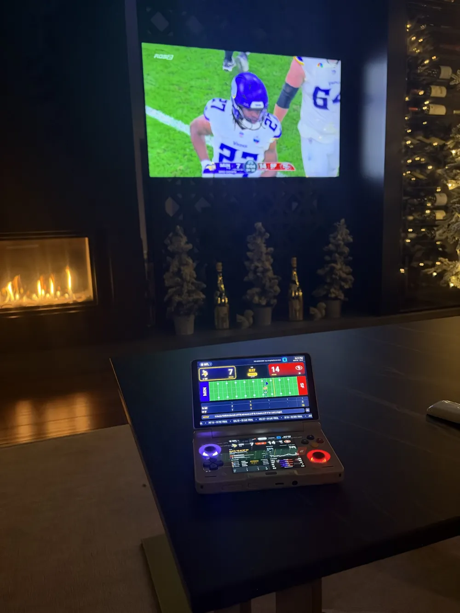
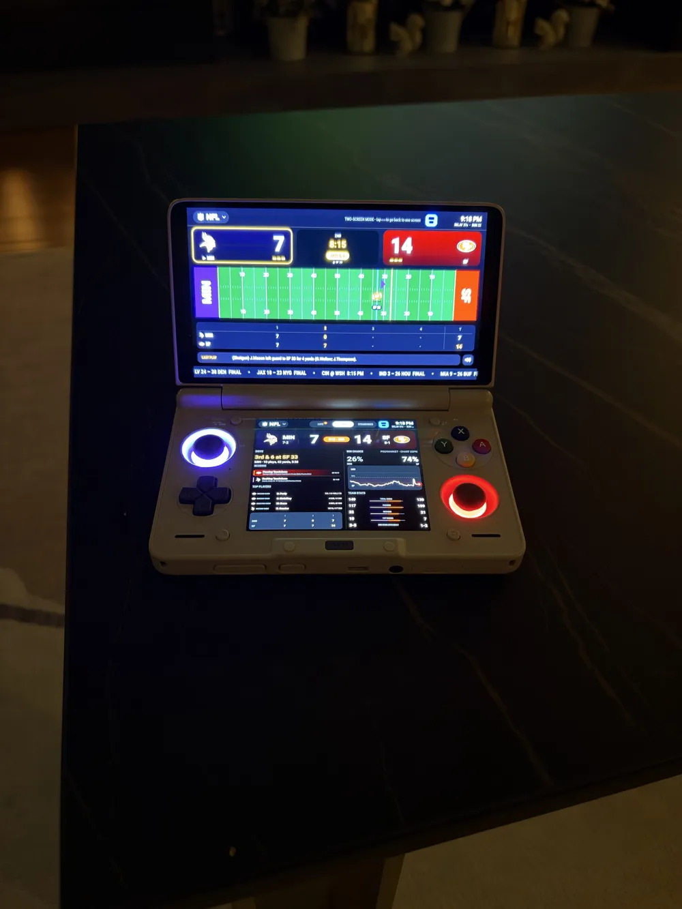
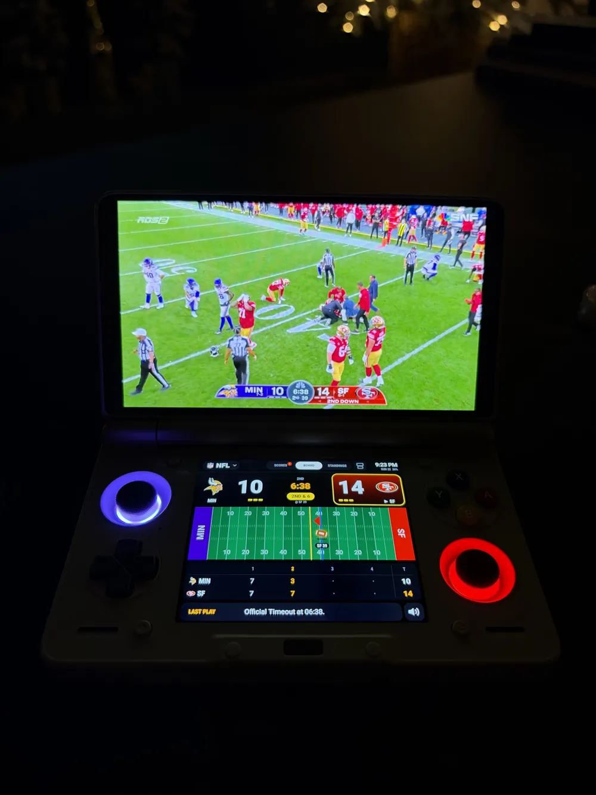
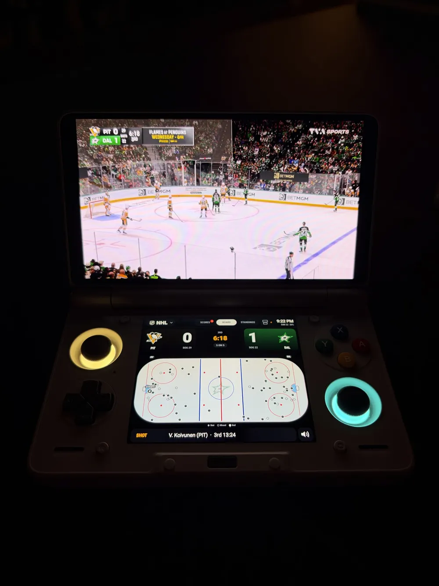
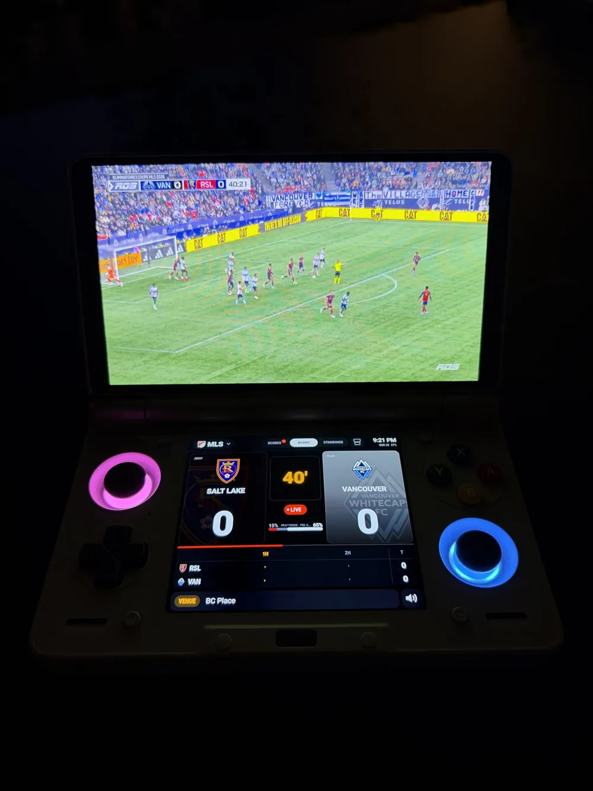
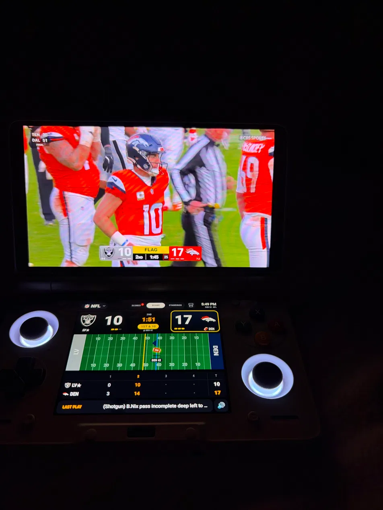

# ThorSport 3.61

Live sports for the **AYN Thor bottom screen** (1240×1080) and the **Retroid Pocket Duo** (1280×960). Everything is drawn to fill the screen exactly.

| Two screens next to the TV | Two screens: Board on top, GAME tab below |
|---|---|
|  |  |
| **NFL Board with the live field** | **NHL Board with the shot map** |
|  |  |
| **MLS Board** | **Board on the Thor's top screen** |
|  |  |

## Download

**[ThorSport.apk — latest release](https://github.com/CHINW3/ThorSport/releases/latest)** · copy it to the Thor and install it. If it opens on the top screen: long-press the icon → Screen Launch → Bottom Screen.

**Updates:** ThorSport checks GitHub for a new version and shows a banner when one is out. Settings → App update downloads and installs it (Android asks once to allow ThorSport to install apps). What changed: [CHANGELOG.md](CHANGELOG.md).

## Leagues
★ MY TEAMS · NHL · AHL · PWHL · NBA · NFL · MLB · WNBA · F1 · League of Legends · Premier League · MLS · Champions League · La Liga · Bundesliga · Serie A · Ligue 1 · College football (NCAAF) · College basketball (NCAAM, NCAAW) · College hockey · EFL Championship, League One, League Two · Cricket · International: World Cup, UEFA Nations League, Concacaf Nations League, international friendlies, Olympic hockey (men and women)

Club soccer leagues are grouped in a **SOCCER** folder in the league menu, national teams (soccer and hockey) in an **INTL** folder, all the college sports (football, basketball, hockey) in a **COLLEGE** folder, and cricket in a **CRICKET** folder (Test, One-day, T20, Women's, Domestic). The AHL comes from the league's own feed (like the PWHL): scores, standings by division, and the playoff picture (top 4 of each division).

## Two-screen mode
Tap the **two-screen button** (the little ▭ icon next to the tabs) or Settings → Two-screen mode.
- **Off**: ThorSport stays on the bottom screen; the top screen is free to watch the game.
- **On**: the top screen shows a giant Board for the game you follow; the bottom keeps Scores and Standings.
  Goals, banners and favorites show on both. Tap the button again (top or bottom) to free the top screen.
The mode is remembered next time you open the app.

## Screens
- **SCORES**: game cards with logos and team colors, live progress, odds, TV channel; ‹ › for other days; ★ MY TEAMS filter.
- **BOARD**: arena scoreboard for one game: big logos, glowing period/clock, shots (NHL), bases & count (MLB),
  down & distance (NFL), win chances, period table, goal scorers / top players, last play, series, venue.
  Tap a score for big score mode. Swipe ← → for other games.
- **BOARD for live baseball**: a field graphic with lit bases and runner names, batter at the plate, pitcher on
  the mound, ▲/▼ inning, ball-strike-out lights, inning-by-inning line score, at-bat and pitcher stats, last play.
  Shows only while a game is live; Settings → Baseball field demo shows it with a sample game.
- **BOARD for live NFL**: animated field: the ball glides to each new spot, blue line of scrimmage, yellow
  first-down line, drive arrows, glowing red zone, end zones in team colors; down & distance, timeouts, 🏈 possession.
  Settings → Football field demo shows it with a sample drive.
- **BOARD for NHL**: live shot map on an ice rink: every shot and goal where it was taken (NHL play-by-play),
  goals as glowing pucks with the scorer, newest shot animated, power play / empty net banner, shots on goal.
  Turn it on or off in Settings → NHL shot map. Settings → Hockey rink demo shows it with a sample game.
- **F1**: the race weekend (FP1…Race) with local times, countdown, ✓ / LIVE, last race top 10 with team colors and
  gaps, drivers' and constructors' championships (data: Jolpica). No free live timing exists, so no lap-by-lap order.
- **League of Legends**: matches from every league (lolesports.com feed), series score, and during a live game:
  gold (with lead), kills, towers, dragons, barons, inhibitors.
- **STANDINGS**: one conference/division at a time in big text (tabs at the top, ▲▼ or swipe for more rows;
  Settings → Standings size → FIT ALL to see a whole conference at once). Streaks, playoff line, soccer zones, live dots.
- **★ MY TEAMS**: long-press any team in any league to add it. Shows all your teams' games, Board and table spots.

## Alerts
GOAL! / TOUCHDOWN! screen with your team's colors, confetti, scorer name, goal horn, stick-light flash and (optional) vibration.
In a game with one of your teams, only your team's goals trigger it; games without your teams (or two of your teams) celebrate both sides. Also: 15-min reminder, puck drop (short horn), end of period,
overtime, close game, upset, final and VICTORY! (gold lights). Tight finish for your team: stick lights breathe.

## AYN Thor stick lights
- **No favorite team**: left stick = left team's color, right stick = right team's color (game on the Board).
- **Favorite team**: its two main colors, all the time (e.g. Canadiens: red on the left stick, blue on the right).
- **Two of your favorites playing each other**: each stick shows its own team.
- Goals: the sticks swap the scoring team's two colors. Win: gold. Tight finish: slow pulse.
- Dark team colors are boosted so they're clearly visible; ThorSport re-applies its colors if the Thor resets them
  (screen on, etc.) and hands the lights back to your Thor settings when you leave the app.

## Spoiler delay
Long-press the clock (or Settings → Spoiler delay): big ± buttons and presets, or **SYNC WITH TV**:
scores are hidden, and when the next score happens live a big button asks you to tap the moment you see it on
your stream — the delay is set to exactly that.

## Settings (tap the clock)
Settings opens on a **home of 6 big cards**, each one showing what is set right now. Tap a card (or A) to open its page; **‹** or B goes back, L1 / R1 jump to the next card. Every row has a short line under it saying what it does.
- **Games**: open on · **leagues** (hide the ones you don't care about) · live refresh speed (fast by default) · spoiler delay · hide finished games · auto-open Board · rotate live games · standings size · NHL shot map
- **My teams**: my teams · celebrate all games / my teams · your other games · game reminder · extra alerts · mute alerts for 1 hour
- **Goal**: test a goal · replay last goal · goal screen on/off · style (full / clean / simple) · length · stick lights · flash lights on goals · vibrate on goals · **Effects** (flash, beams, confetti, fireworks, shake)
- **Sound**: sound on/off · volume (low / med / high / max) · **style** (Arena, Classic, Party, Mellow: a whole set of sounds in one tap) · each NHL team's own horn · sound length · menu sounds · test the sound · **Sounds by event** (the sound for a goal, touchdown, field goal, win, home run, OT winner, your other games, 3-pointer; new sound pack or built-in)
- **Display**: two-screen mode · English / Français · screen brightness · stick light brightness · accent color · 12/24 h clock · keep screen on
- **App**: app update · help · **Field demos** (baseball, football, hockey) · clear MY TEAMS · reset settings

## Controller
Always drives the bottom screen (in two-screen mode the top screen follows the game you open).
| Button | Scores | Board | Standings | Menus |
|---|---|---|---|---|
| D-pad / stick | Move card by card (pages turn by themselves) | ← → other game | ↑ ↓ rows, ← → conference | ↑ ↓ items, ← → spoiler delay |
| A | Open the game | Big score | Open the team's game | Select |
| B | Hide selection | Back to Scores | Back to Scores | Close |
| X / Y | ★ left / right team | ★ left / right team | ★ the team | — |

L1 / R1 tabs · L2 / R2 leagues · **right stick ◄ ► = previous / next day (Scores tab)** · Start settings · Select league list · L3 back to today (or refresh) · R3 two-screen mode.
The first press only shows the blue selection. Touching the screen hides it.
While a game runs on the top screen, the Thor sends buttons to the game: tap ThorSport once to control it.

## Controls
| Action | Result |
|---|---|
| Tap the league name | Dropdown of all leagues, with their logos |
| Tap a game card | Follow it on the Board |
| Long-press a team | Add / remove from MY TEAMS |
| Tap a score on the Board | Big score mode |
| Tap the clock | Settings |
| Tap the ▭ button | Two-screen mode on/off |
| Long-press the clock | Spoiler delay panel |
| Tap the date (Scores) | Back to today |

## Build
1. Install **Android Studio** (free) and open this folder.
2. **Build → Generate APKs** (or Build APK(s)). The first build also downloads team logos into the app.
3. Copy `app/build/outputs/apk/debug/app-debug.apk` to the Thor and install it.
4. If it opens on the top screen: long-press the icon → **Screen Launch → Bottom Screen**.

## Battery & data
ThorSport pauses itself (no refresh, lights handed back) when it's fully hidden, refreshes faster only when a
game is live, slows down at night and below 15 % battery, and keeps the last data on the device for instant starts.

## Data sources
ESPN public feeds (scores, standings, odds), NHL API (goal scorers, shot map), HockeyTech (PWHL), Jolpica (F1),
lolesports.com (League of Legends), Polymarket (win chances).
All are free and unofficial; if one changes, that part shows "No connection" and the rest keeps working.
Stick lights use the same LED files as the open-source AmbiAnalog app.
